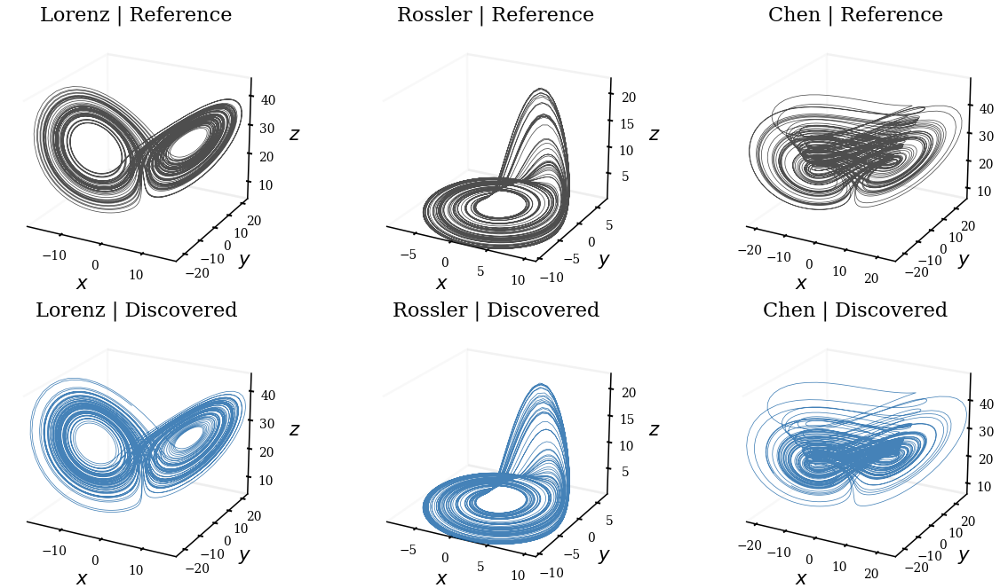
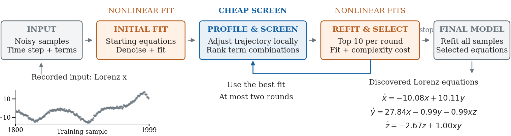
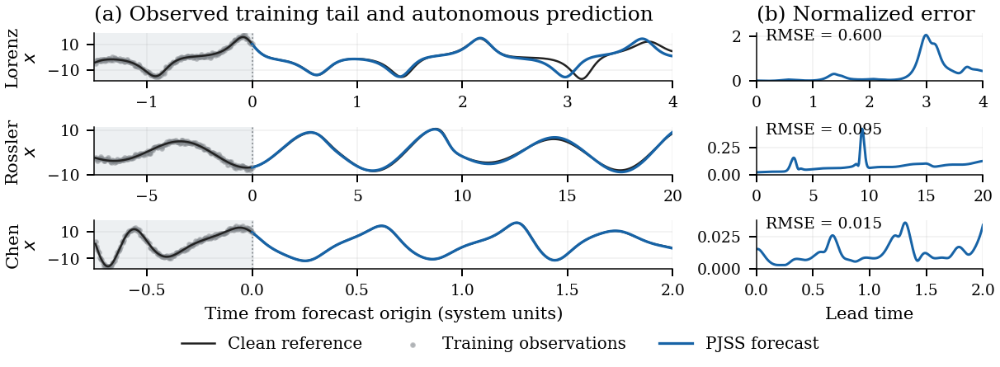
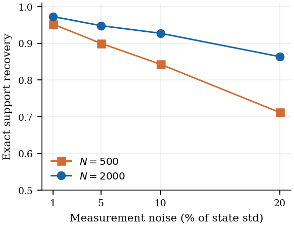

# PJSS: Profiled Joint Subset Search

**Discover sparse differential equations from a single noisy trajectory.**

PJSS learns the equation terms, their coefficients, and a denoised trajectory together. It searches combinations of candidate terms with a cheap local approximation, then spends nonlinear optimization on the most promising models. The result is an explicit dynamical system you can inspect, integrate, and compare with observations.

[Method](#how-it-works) · [Results](#benchmark-results) · [Quick start](#quick-start) · [API](#libraries-and-options) · [Reproduction](#tests-and-reproduction) · [Manuscript](docs/paper/main.tex)



*Reference systems above, equations recovered by PJSS below. Each learned system runs autonomously for 8,000 samples after a 1,000-sample burn-in, without assimilating observations. These examples show recovered geometry; forecast accuracy is evaluated separately below.*

## At a glance

- **One noisy trajectory in, explicit equations out.** Supply observations and a sampling interval; PJSS selects sparse terms from a candidate library without being given the true sparsity or noise level.
- **Joint denoising and discovery.** The fit accounts for measurement error and consistency with the dynamics instead of treating noisy numerical derivatives as exact targets.
- **Subset search with selective refitting.** Screen alternative term combinations in a profiled quadratic model, then jointly refit the best candidates.
- **Several library and noise models.** Cubic, higher-degree polynomial, polynomial-plus-trigonometric, and higher-dimensional variants share the `eqdisc.discover` entry point.
- **Broad evaluation.** 6,160 trajectories across 77 in-library chaotic systems, paired comparisons with DEDi, component ablations, and stored reproducibility audits.

## How it works



Given observations $y_i = x(i\Delta t) + e_i$, PJSS seeks a sparse coefficient matrix $C$ in

$$\dot{x} = C^\top\theta(x),$$

where $\theta(x)$ is the supplied library of candidate functions. For a three-dimensional cubic library, these are 20 monomials per equation.

1. **Fit states and coefficients jointly.** For a proposed support, optimize a robust observation loss together with a midpoint-rule dynamics residual. The state block is banded, with a small dense coefficient border, giving linear cost in trajectory length per solver iteration for fixed state dimension and library size.
2. **Profile out local state changes.** Eliminate state increments from the Gauss–Newton quadratic through a Schur complement. This estimates how well a different coefficient support could fit after the trajectory adjusts.
3. **Search supports, then refit.** For the cubic library, rank subsets of up to five terms per equation. Retain the best proposals and perform nonlinear joint fits on the ten best unfitted candidates per round, for at most two rounds by default. Larger libraries use beam search.
4. **Select and refit the final model.** Compare models with a BIC-inspired score, an autocorrelation correction, and a degree-weighted complexity penalty. Refit the selected support using all observations.

The subset enumeration is exact within each screened size-limited equation problem; the overall nonlinear search is local. Every third observation is masked during candidate fitting, but preprocessing uses the full record, so this internal selection score is not an independent temporal holdout.

See the [method section](docs/paper/sections/method.tex) for the objective, solver, proposal construction, and selection rule.

## From measurements to equations and predictions

The fixed Lorenz example uses 2,000 observations with 10% Gaussian measurement noise. PJSS recovers all seven true terms with no extras and a relative coefficient error of **0.66%**:

$$
\begin{aligned}
\dot{x} &= -10.084x + 10.110y, \\
\dot{y} &= 27.844x - 0.989y - 0.994xz, \\
\dot{z} &= -2.668z + 1.003xy.
\end{aligned}
$$

The reference Lorenz coefficients are $(-10,10)$, $(28,-1,-1)$, and $(-8/3,1)$. Displayed coefficients are rounded; integration uses the full fitted values.



*Models fit 2,000 noisy training samples and forecast the next 400 withheld samples. Forecast initialization is estimated from the final 40 noisy training observations, not the clean state. Gray points are training observations, black curves are clean reference trajectories, and blue curves are PJSS predictions.*

| Fixed example | Correct terms | Relative coefficient error | Forecast RMSE, first 100 samples | Forecast RMSE, all 400 samples |
| --- | ---: | ---: | ---: | ---: |
| Lorenz | 7/7, no extras | 0.66% | 0.038 | 0.600 |
| Rössler | 7/7, no extras | 0.25% | 0.060 | 0.095 |
| Chen | 7/7, no extras | 1.93% | 0.008 | 0.015 |

RMSE normalizes each coordinate by its clean training standard deviation. Sampling intervals differ across systems, so equal sample counts represent different physical horizons. These three fixed illustrations are separate from the aggregate benchmark. Their [inputs, fitted models and protocol](docs/cvis2026/evidence/) are documented alongside the figure-generation code; raw `.npz` inputs are not bundled in this repository.

## Benchmark results

### Recovery across 77 chaotic systems

The `dysts` evaluation contains **6,160 trajectories**: 77 in-library systems × two record lengths × four measurement-noise levels × ten replicates. It includes 61 three-dimensional systems with degree at most three and 16 systems of dimension four to six with degree at most two. Exact support recovery requires every equation to contain precisely the correct terms.

| Evaluation set | Exact support recovery | System-resampled 95% interval |
| --- | ---: | ---: |
| All 77 systems | **89.0%** | 84.1–93.1% |
| 49 systems outside development benchmarks | **85.3%** | 78.3–91.4% |



*Each point averages 770 trajectories. Longer records improve recovery across the tested noise levels. These are the historical frozen-model benchmark results; the current implementation is v1.2.0.*

### Paired comparison with DEDi

The comparison uses the authors' DEDi implementation and its full 35-setting grid. Both methods receive the same trajectories; DEDi's model is selected by validation error or BIC.

| Method and selection rule | Core conditions, 80 runs | New systems, 64 runs from 35 systems |
| --- | ---: | ---: |
| **PJSS** | **66/80** | **53/64** |
| DEDi, validation selection | 55/80 | 36/64 |
| DEDi, BIC selection | 61/80 | 41/64 |

On the new-system comparison, PJSS has 15 paired wins and three losses against DEDi-BIC. On core conditions, the 66 versus 61 result does not establish superiority; excluding colored noise, both recover 56/64. The two studies use different system sets and are not pooled. Details: [core comparison](docs/reports/h2h.md), [new-system comparison and timing](docs/reports/revision.md).

### What contributes to recovery?

Ablations cover 576 paired runs across white noise, colored noise, a high-noise stress set, and three-dimensional `dysts` systems:

- Removing support proposals loses **32** recoveries and gains none.
- Replacing subset enumeration with forward stepwise selection loses **28** recoveries and gains none.
- Keeping enumeration but holding states fixed during proposals recovers **480/576**, compared with **490/576** for PJSS. Both retain joint nonlinear refits.

The larger gain comes from searching alternative supports; profiling adds a smaller, setting-dependent improvement. See the [ablation section](docs/paper/sections/ablation.tex).

## Quick start

Requires **Python 3.10+**. Core dependencies are NumPy, SciPy, and Numba.

```bash
git clone https://github.com/iamyanbo/PJSS.git
cd PJSS
python -m pip install -e .
```

Generate a noisy Lorenz trajectory and recover its equations:

```python
import numpy as np
from eqdisc import discover
from eqdisc.core import SYSTEMS, X0, DT, simulate

clean = simulate(
    SYSTEMS["lorenz"], X0["lorenz"], DT["lorenz"],
    2000, burn=1000,
)
rng = np.random.default_rng(0)
y = clean + 0.05 * clean.std(axis=0) * rng.standard_normal(clean.shape)

result = discover(y, DT["lorenz"])
print(result.equations())

coefficients = result.xi       # coefficients in original units
terms = result.names          # library term names
ambiguous = result.ambiguous  # close competition between candidate models
confidence = result.confidence
```

For your own data, pass a NumPy array with shape `(n_samples, n_state_variables)` and the uniform sampling interval:

```python
result = discover(observations, dt=0.01)
```

## Libraries and options

| Setting | Usage | Behavior |
| --- | --- | --- |
| Default library | `discover(y, dt)` | Degree-three polynomials for 3-D data; degree-two polynomials for other dimensions |
| Higher-degree library | `library="poly4"` or `"poly5"` | 35 or 56 terms per equation in 3-D, with beam-search proposals |
| Polynomial + trigonometric | `library="trig3"` | Cubic monomials plus sine/cosine of each state |
| Automatic noise model | `noise="auto"` | Switches to AR(1) when the estimated lag-one correlation exceeds 0.6 in 3-D |
| Fixed noise model | `noise="white"` or `"ar1"` | Selects the observation-noise model explicitly |
| Historical implementation | `version="1.0.1"`, `"1.1"`, or `"1.2"` | Reproduces version-specific behavior; default is v1.2 |
| Candidate inspection | `return_candidates=True` | Adds the scored candidate pool to `result.info` |

AR(1) handling is implemented for three-dimensional systems only. For repeated degree-four/five runs, set `EQ_DEG=4` or `5` before starting Python to avoid per-call subprocess startup. Inclusion confidences and the ambiguity flag describe competing candidate models; they do not certify the generating equation. See the [full API and version notes](RESEARCH_README.md#options).

## Tests and reproduction

```bash
python -m pip install -e ".[test]"

# Fast solver and baseline-randomness checks
python -m pytest tests/test_flow_discovery.py tests/test_baseline_reproducibility.py -q

# End-to-end synthetic Lorenz smoke test
python -m pytest tests/test_smoke.py -q

# Recompute reported summaries from stored results
python docs/paper/scripts/verify_numbers.py
```

The fast checks passed **14 tests** when preparing this repository. The stored-number verifier also completed; it reads saved fits rather than rerunning discovery. The recorded research audit checks **44,424 coefficient arrays** against saved metrics and **5,250 raw DEDi fits** for completeness and consistency.

Full benchmark reruns require the corresponding trajectory archives and optional baseline dependencies. Large raw archives are not bundled here; [data/MANIFEST.sha256](data/MANIFEST.sha256) identifies them. For historical-equivalence tests, set `EQDISC_FROZEN_SRC` to `reference/frozen_ac7ab20` and provide the required archives. The [research README](RESEARCH_README.md#reproducing-the-tables) documents generators, versions, commands, and the specific historical baseline/archive issues. Optional baseline setup is described in [THIRD_PARTY.md](THIRD_PARTY.md).

## Repository map

| Location | Contents |
| --- | --- |
| [`eqdisc/`](eqdisc/) | Discovery API, joint solvers, subset proposals, noise models, and confidence diagnostics |
| [`benchmarks/`](benchmarks/) | Data generation, baseline comparisons, ablations, and audit scripts |
| [`tests/`](tests/) | Unit, smoke, baseline-reproducibility, and historical-equivalence tests |
| [`docs/paper/`](docs/paper/) | Full manuscript source, method details, results, and figures |
| [`docs/cvis2026/`](docs/cvis2026/) | Compact paper sources, illustrations, and figure-generation code |
| [`docs/reports/`](docs/reports/) | Experiment reports and development history |
| [`results_submission_audit/`](results_submission_audit/) | Stored coefficient, archive, randomness, and interval audits |
| [`reference/frozen_ac7ab20/`](reference/frozen_ac7ab20/) | Historical source snapshot used by equivalence tests |

## Scope

PJSS is evaluated primarily on uniformly sampled, fully observed trajectories with generating equations inside the chosen library. Small terms, fast dynamics, model misspecification, and measured-data applications remain challenging. The repository includes negative measured-pendulum results as well as synthetic successes; see the [scope discussion](docs/paper/sections/limitations.tex) for where the current evidence applies.
